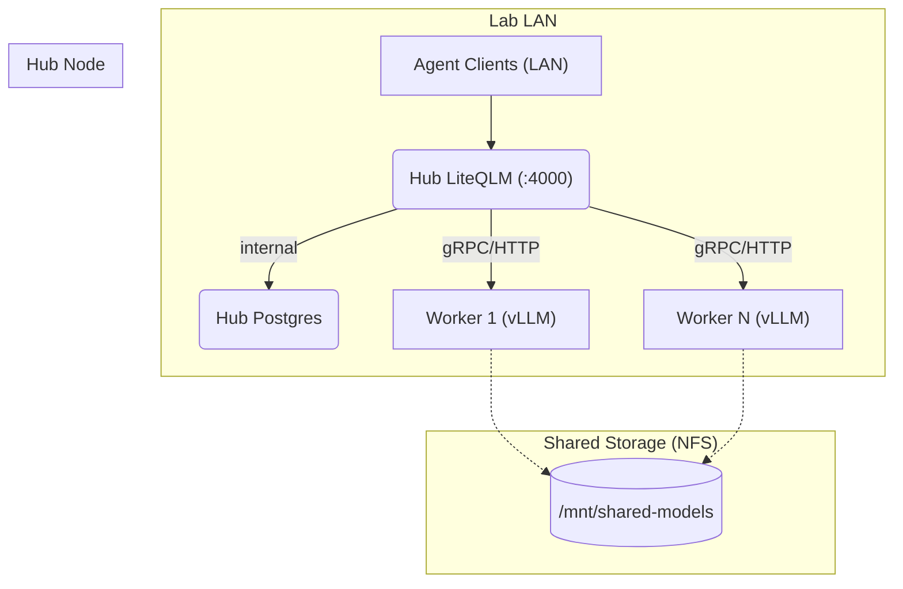

# Spark Kit: Multi-Node DGX LLM Stack

## 1. Topology
The stack is designed to be deployed across multiple NVIDIA DGX Spark nodes in a lab environment. One node acts as the **Hub**, while others act as **Workers**.

### Architecture Diagram


## 2. Directory Structure
- `infrastructure/`
  - `hub/`: Docker Compose stack and deployment scripts for the Hub node (LiteQLM + Postgres).
  - `worker/`: Bash deployment script for individual vLLM worker nodes.
- `security.md`: Standards for container hardening, non-root execution, and network isolation.
- `cache.md`: Guidelines for model caching to minimize lab bandwidth usage.

## 3. Deployment Guide

### Step 1: Stop Existing Manual Containers (If Applicable)
If deploying on a node with an existing manual setup, stop the old containers first:
```bash
docker stop litellm-new qwen36-vllm
docker rm litellm-new qwen36-vllm
```

### Step 2: Provision Shared Model Cache (Optional but Recommended)
On the designated Hub node, export `/mnt/shared-models` via NFS. Follow the steps in [cache.md](./cache.md).

### Step 3: Deploy the Hub
On the node intended to be the Hub:
```bash
cd spark-kit/infrastructure/hub
sudo ./deploy.sh
```
This will create a service user, set up strict firewall rules, and start LiteQLM + Postgres.
- **Hub API Endpoint**: `http://<HUB_LAN_IP>:4000/v1`

### Step 4: Deploy Workers
On each Worker node:
```bash
cd spark-kit/infrastructure/worker
sudo ./deploy.sh
```
Workers are strictly firewalled against internet access and only allow traffic from the Hub's subnet.

## 4. Model Agnosticism
To deploy a different model, modify the `MODEL_NAME` variable in the worker's environment:
```bash
# Example: Switch to qwen3.8-flash-next
export MODEL_NAME="nvidia/qwen3.8-flash-next"
sudo ./deploy.sh
```

## 5. Security & Monitoring
- **Network**: No port forwarding, no public IPs. All access is restricted to internal LAN ranges via `ufw`.
- **Non-root**: All containers run under the `llm-svc` user on both Hub and Worker nodes.
- **Monitoring**: To be addressed in a future phase (Grafana/Loki stack).

## 6. Current State Notes
- **Active Model**: `nvidia/Qwen3.6-35B-A3B-NVFP4`
- **GPU Memory Budget**: `0.4` (approx. 52GB for vLLM)
- **Critical Flags**: `--tool-call-parser qwen3_xml` and `--enable-auto-tool-choice` must be present for structured tool outputs.
