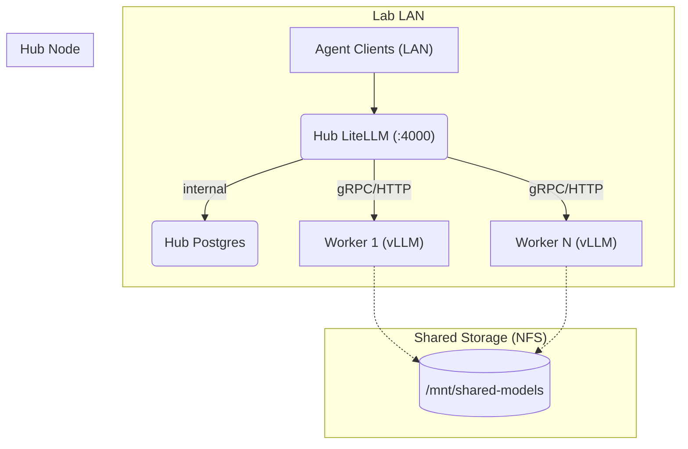

# Spark Kit: Multi-Node DGX LLM Stack

## 1. Topology

The stack is designed to be deployed across multiple NVIDIA DGX Spark nodes in a lab environment. One node acts as the **Hub**, while others act as **Workers**.

### Architecture Diagram



## Note on prior-stage assumptions

During the prior agent stage that produced much of Stage 1, a set of incorrect assumptions were made and documented as if they were facts. Concrete examples:

- The worker vLLM container was assumed to run non-root when it runs as the image-default (root) user.
- `--security-opt=no-new-privileges` was documented as applied when it was present only as a comment in the deployment script.
- Hub port 4000 was assumed to be published to the LAN when the compose file had no port mapping at all.
- `scripts/agent-deploy.sh` and node-marker files (`.hub-node` / `.worker-node`) were referenced in the docs though they did not exist.
- The GB10 was described as having 8 GPUs; it is a single Grace-Blackwell SoC with one unified GPU and 128 GB unified memory.
- A 24 GB GPU SKU was listed for the DGX Spark; no such SKU exists.
- `gpu_utilization 0.6` was claimed in the deployment manifest while the code uses 0.4.

An independent adversarial audit of the committed files caught these defects, and they have now been corrected or explicitly documented as unimplemented. These assumptions were made by the agent session running model `qwen3.5:9b`, which is the source of the confusion documented here.

**Known residual**: the worker vLLM container still runs as the image-default (root) user, pending on-node validation.

## 2. Directory Structure

- `infrastructure/`
  - `hub/`: Docker Compose stack and deployment scripts for the Hub node (LiteLLM + Postgres). Contains:
    - `deploy.sh`: Starts the committed docker-compose.yml stack (non-sudo, no user creation)
    - `config.yaml`: Model routing configuration for LiteLLM
    - `docker-compose.yml`: Hub stack definition, used by deploy.sh as-is
    - `provision-nfs.sh`: Provisions the optional NFS model-cache export (see `cache.md`)
    - `smoke-test.sh`: Validation script for the compose structure
    - `smoke-test-report.md`: Static smoke-test report (no runtime verification)
  - `worker/`: Bash deployment script for individual vLLM worker nodes
- `security.md`: Standards for container hardening, non-root execution, and network isolation
- `cache.md`: Guidelines for model caching to minimize lab bandwidth usage via NFS

## 3. Deployment Guide

### Step 1: Stop Existing Manual Containers (If Applicable)

If deploying on a node with an existing manual setup, stop the old containers first:

```bash
docker stop litellm-new qwen36-vllm
docker rm litellm-new qwen36-vllm
```

### Step 2: Provision Shared Model Cache (Optional but Recommended)

On the designated Hub node, export `/mnt/shared-models` via NFS. Follow the steps in `cache.md`.

```bash
cd "/path/to/Spark Kit"
sudo ./infrastructure/hub/provision-nfs.sh   # Creates NFS export at /mnt/shared-models
```
### Step 3: Deploy the Hub (Non-Sudo Mode)
On the node intended to be the Hub:

```bash
# Optional: Provision shared model cache NFS export (may require sudo once):
cd "/path/to/Spark Kit/infrastructure/hub"
# sudo ./provision-nfs.sh  # Only needs root for /mnt directory and NFS exports

# Deploy Hub stack (works as regular user, no sudo required):
./deploy.sh
# Creates .env file, starts LiteLLM + Postgres containers
```

This will:
- Generate `.env` file with secure random API keys and DB password
- Start LiteLLM on port 4000 + Postgres on localhost via docker-compose.yml
- Containers run as the current host user (no service user is created); `--security-opt=no-new-privileges` is available as additional hardening (not currently enabled in the hub compose file)

**Manual Firewall Configuration** (configure host firewall if needed):
```bash
# Allow port 4000 from trusted LAN subnet only:
# sudo ufw allow from <TRUSTED_SUBNET> to any port 4000 proto tcp comment 'LiteLLM Hub'
# Or skip firewall if running in airgapped environment with no external access
```

**Hub API Endpoint**: http://\<HUB_LAN_IP\>:4000/v1


### Step 3a: Deploy Workers (Non-Sudo Mode)

On each Worker node:

```bash
# Optional: Mount shared model cache from Hub (requires sudo for mount command):
if [ -d "/mnt/shared-models" ]; then 
  mountpoint -q /mnt/shared-models || \
  # sudo mount -t nfs <HUB_IP>:/mnt/shared-models /mnt/shared-models; fi

# Deploy worker vLLM container (non-sudo):
cd "Spark Kit/infrastructure/worker"
export MODEL_NAME="nvidia/Qwen3.6-35B-A3B-NVFP4"  # or your model choice
./deploy.sh  # No sudo required - runs as regular user

# Optional: Configure worker firewall rules manually if needed:
# sudo ufw allow from <HUB_SUBNET> to any port 8000 comment 'Worker Hub Access'
```

Workers bind vLLM to 0.0.0.0:8000 (host networking) and are restricted to the Hub subnet by firewall. The Hub routes to the worker at its LAN IP on port 8000 (`config.yaml` → `api_base`; same-host deployments use `host.docker.internal`).

> **Container user note**: the worker vLLM container runs as the image-default (root) user with `--security-opt=no-new-privileges` applied; non-root execution is pending on-node validation.

Workers are strictly firewalled against internet access and only allow traffic from the Hub's subnet (configure firewall manually if needed).

## 4. Model Agnosticism

To deploy a different model, modify the `MODEL_NAME` variable in the worker's environment before running deploy.sh:

```bash
export MODEL_NAME="nvidia/qwen3.8-flash-next"  # example alternative
./deploy.sh  # No sudo required
```

## 5. Security & Monitoring

### Network Isolation
- No port forwarding, no public IPs
- All access restricted to internal LAN ranges via `ufw`
- Hub: Port 4000 exposed only to specific LAN IP(s)
- Worker: port 8000 (vLLM) firewalled to the Hub subnet only; manual `ufw` rules

### Container Hardening
- Hub: containers run as the current host user; Worker: runs as the image-default (root) user with `--security-opt=no-new-privileges` applied (non-root pending on-node validation)
- API keys stored in `.env` files (mode 600), never hardcoded
- Secrets generated via `openssl rand` commands

### Monitoring (Stage 1)
- Basic observability via Docker logging drivers and health checks
- Stage 2 will add Grafana/Loki stack when deployed

## 6. Current State Notes

- **Active Model**: `nvidia/Qwen3.6-35B-A3B-NVFP4`
- **GPU Memory Budget**: 0.4 (approx. 52GB for vLLM on GB10)
- **Critical Flags**: `--tool-call-parser qwen3_xml` and `--enable-auto-tool-choice` required for structured tool outputs

---

## Appendix A: docker-compose.yml Structure

The Hub deployment uses Docker Compose to orchestrate LiteLLM and Postgres. The compose file (committed to the repo and used by `deploy.sh` as-is) includes:

- **litellm-hub**: Main proxy service listening on port 4000
- **postgres**: PostgreSQL database with pgvector extension for vector embeddings
- Network isolation via dedicated `llm-net` bridge
- Volume mounts for Postgres data and model cache (NFS)
- Health checks for all services

See `security.md` for detailed security standards and `cache.md` for NFS configuration.
